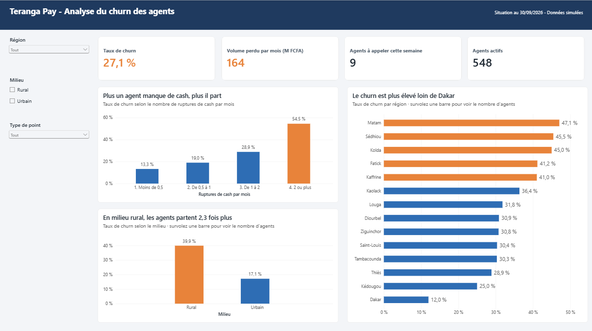
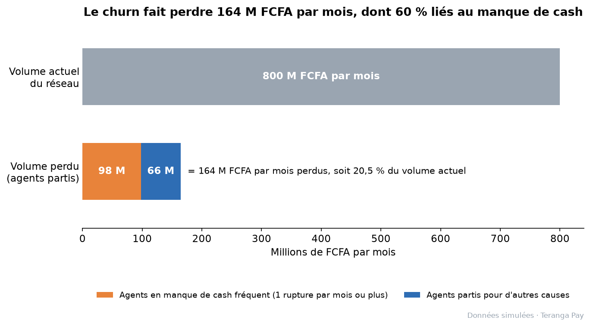
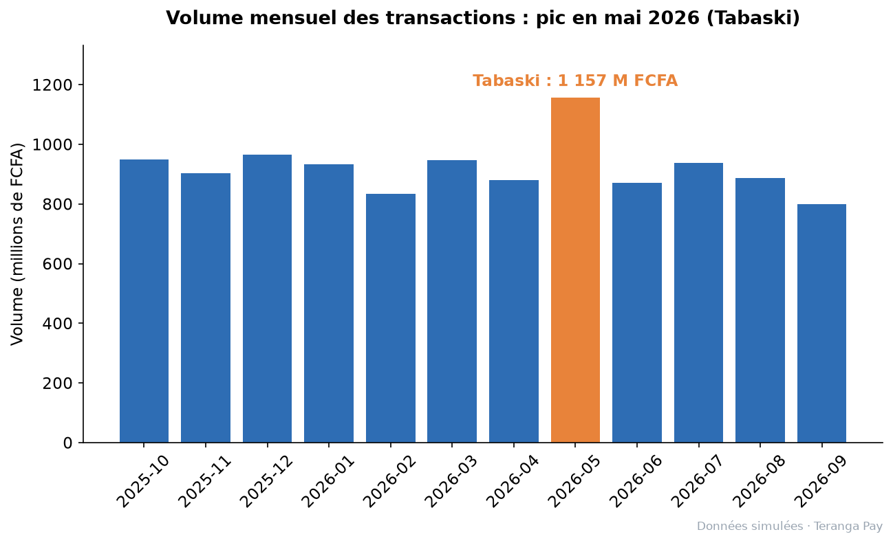
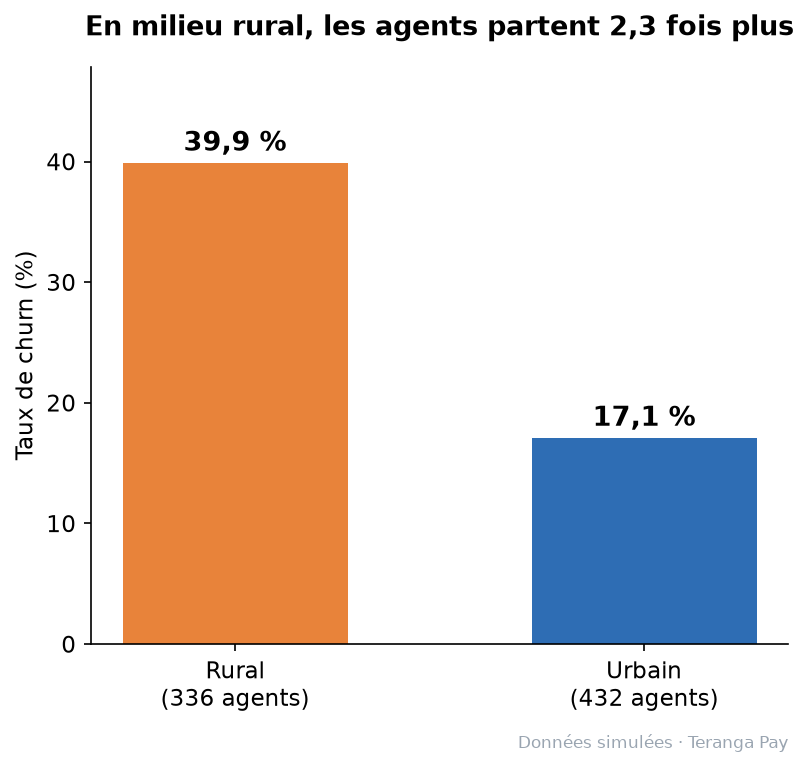
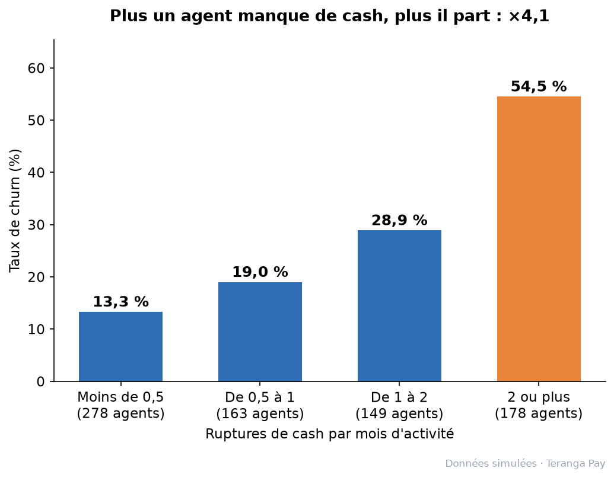
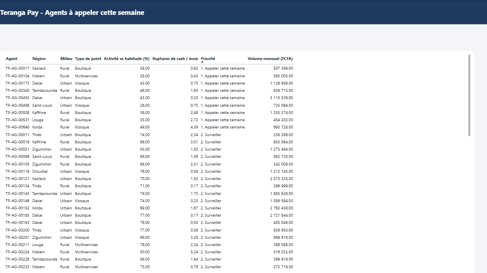

# 📉 Teranga Pay : analyse du churn d'un réseau d'agents Mobile Money au Sénégal

> **Projet portfolio Data Analyst** · SQL (PostgreSQL) · Python (pandas, matplotlib) · Power BI
> ⚠️ *Données 100 % simulées. « Teranga Pay » est un opérateur fictif, inspiré des enjeux du marché sénégalais. Aucune donnée réelle d'opérateur n'est utilisée.*

## ⚡ En bref

Sur un réseau simulé de **800 agents** et **576 000 transactions** (12 mois, 14 régions du Sénégal), j'ai construit une analyse de bout en bout (base PostgreSQL, SQL, Python, Power BI) pour comprendre **pourquoi les agents Mobile Money abandonnent** et **lesquels appeler en priorité**.

| Résultat clé | Chiffre |
|---|---|
| Taux de churn des agents | **27,1 %** (208 agents partis sur 768 activés) |
| Volume perdu chaque mois | **164 M FCFA**, soit **20 %** du volume du réseau |
| Premier facteur de départ | les **ruptures de cash** : churn **×4,1** (13 % → 55 %) |
| Agents à risque détectés à l'avance | **73 agents**, dont **9 à appeler cette semaine** (78 M FCFA/mois en jeu) |



---

## 1. Le problème métier

Un réseau Mobile Money repose sur ses **agents** (boutiques, kiosques, multiservices) : ce sont eux qui transforment le cash en monnaie électronique, et inversement. Quand un agent décroche, toute une zone perd son point d'accès, en particulier en milieu rural.

**Questions posées :**
1. Combien d'agents sont actifs, à risque, partis ou jamais activés ? Quel volume mensuel est en jeu ?
2. Quels facteurs sont associés au churn : région, milieu, type de point, **ruptures de liquidité**, ancienneté ?
3. Peut-on détecter un agent **avant** qu'il ne parte ?
4. Quelles actions concrètes recommander au réseau ?

## 2. Les données (simulées)

| Table | Lignes | Contenu |
|---|---|---|
| `dim_region` | 14 | Les 14 régions du Sénégal + indice d'éloignement |
| `dim_date` | ~1 600 | Calendrier avec fins de mois et fêtes (Korité, Tabaski, Magal…) |
| `dim_agent` | 800 | Agents : région, milieu, type de point, date de recrutement |
| `dim_client` | 12 000 | Clients pseudonymisés (aucun nom, aucun téléphone) |
| `fact_transactions` | ~576 000 | 12 mois de transactions (oct. 2025 à sept. 2026) |
| `fact_ruptures_liquidite` | ~8 800 | Incidents de rupture de cash / e-money |

Le simulateur ne « plante » pas les agents en churn : chaque agent a une **probabilité** de partir qui dépend de facteurs réalistes, et ces variables restent **cachées**. L'analyse doit retrouver les causes à partir des seules données observables, comme dans une vraie entreprise. Des anomalies (doublons, montants manquants ou négatifs, régions mal saisies) sont injectées volontairement pour l'étape de nettoyage. Détail : [`docs/dictionnaire_donnees.md`](docs/dictionnaire_donnees.md).

**Statuts des agents** (au 30/09/2026) : Actif (dernière transaction ≤ 14 jours) · À risque (15 à 30 jours) · Churn (> 30 jours) · Jamais activé.

## 3. Architecture

```
python/01_generer_donnees.py
        │
        ▼
CSV bruts ──► schéma staging ──► nettoyage SQL ──► schéma analytics (modèle en étoile)
              (PostgreSQL)       (doublons, valeurs     │
                                  manquantes, régions)  ├──► analyses SQL (sql/06 à 12)
                                                        ├──► graphiques Python (python/03)
                                                        └──► dashboard Power BI (2 pages)
```

**Choix clé :** les calculs complexes (volume mensuel par agent, ruptures par mois, signal d'alerte) sont faits **une seule fois en SQL**, dans la vue `analytics.v_statut_agents`. Python et Power BI se contentent de les afficher : **les mêmes chiffres partout**.

## 4. Structure du projet

```
teranga-pay-churn/
├── python/
│   ├── 01_generer_donnees.py      # simulateur (seed = 42, reproductible)
│   ├── 02_charger_postgres.py     # chargement + nettoyage automatiques
│   └── 03_graphiques.py           # graphiques des résultats
├── sql/
│   ├── 01 à 05                    # schémas, nettoyage, contrôles qualité, validation
│   ├── 06_exploration.sql         # premières explorations (effet Tabaski)
│   ├── 07_segmentation_churn.sql  # statuts des agents
│   ├── 08_profil_churn.sql        # qui part le plus ? (milieu, région, zone)
│   ├── 08b_vue_dashboard.sql      # vue enrichie pour Power BI
│   ├── 09_liquidite_churn.sql     # ruptures de cash et churn
│   ├── 10_cohortes_recrutement.sql
│   ├── 11_signal_faible.sql       # détection précoce + backtest
│   └── 12_impact_fcfa.sql         # coût du churn
├── powerbi/
│   ├── teranga_pay_dashboard.pbix # dashboard (2 pages)
│   └── theme_teranga_pay.json     # thème de couleurs commun avec Python
├── docs/
│   ├── dictionnaire_donnees.md
│   ├── journal_sprints.md         # démarche, problèmes rencontrés et solutions
│   └── img/                       # graphiques et captures du dashboard
└── README.md
```

## 5. Lancer le projet

```bash
pip install -r requirements.txt
python python/01_generer_donnees.py      # génère data/raw/*.csv (reproductible, seed = 42)
python python/02_charger_postgres.py     # crée la base, charge, nettoie
```
Puis, dans pgAdmin : exécuter `sql/08b_vue_dashboard.sql` (crée la vue utilisée par Python et Power BI).
```bash
python python/03_graphiques.py           # génère les graphiques dans docs/img/
```
Enfin, ouvrir `powerbi/teranga_pay_dashboard.pbix` et cliquer sur **Actualiser**.

## 6. Résultats clés

> *Données simulées. Chiffres issus des requêtes du dossier `sql/`.*



**Insight 1 : l'effet Tabaski.** Pendant la Tabaski, le volume quotidien de transactions atteint **49,2 M FCFA**, soit **1,7 fois** la moyenne du reste de l'année (29,6 M FCFA). La part des transferts passe de **23,9 % à 36,5 %**. *(sql/06_exploration.sql)*



**Insight 2 : churn rural ou urbain.** En milieu rural, le taux de churn des agents atteint **39,9 %**, contre **17,1 %** en ville, soit **2,3 fois plus**. L'analyse de la liquidité (Insight 3) montre que les ruptures de cash en sont un facteur majeur. *(sql/08_profil_churn.sql)*



**Insight 3 : la liquidité, premier facteur de churn.** Les agents qui subissent 2 ruptures de cash ou plus par mois partent **4,1 fois plus** (54,5 % de churn, contre 13,3 % pour ceux qui en ont moins de 0,5 par mois), avec une **gradation** régulière entre les deux. Ces ruptures sont **6,2 fois plus fréquentes** chez les agents ruraux des zones éloignées que chez les agents urbains proches de Dakar. *(sql/09_liquidite_churn.sql)*



**Insight 4 : les premiers mois, une période fragile.** À exposition égale, les nouveaux agents partent **1,6 fois plus** pendant leurs 6 premiers mois que les agents déjà en place (20,7 % contre 13,1 %). Le groupe des nouveaux est encore petit (58 agents) : c'est une tendance à surveiller, bien plus faible que l'effet de la liquidité. Par cohorte trimestrielle, aucune tendance claire n'apparaît. *(sql/10_cohortes_recrutement.sql)*

**Insight 5 : détecter les départs à l'avance.** Un signal simple (activité des 30 derniers jours comparée à la moyenne des 3 mois précédents) permet de repérer les agents à risque. Testé sur le passé (backtest au 30/06/2026), il fonctionne : les agents dont l'activité avait chuté de plus de moitié sont partis à **80 %** dans les 3 mois suivants, contre **6,3 %** pour les agents stables (×12,7, sur un petit groupe de 10 agents) ; la baisse modérée donne ×2,8 (56 agents). Appliqué au 30/09/2026, il produit une liste de **9 agents à appeler en priorité** (dont 6 ruraux) et de **64 agents à surveiller**. **Limite :** il repère environ 1 départ sur 3. *(sql/11_signal_faible.sql)*

**Insight 6 : le coût du churn.** Les 208 agents partis représentent une perte de **164,2 M FCFA par mois**, soit **20,5 %** du volume actuel du réseau (800,1 M FCFA sur 30 jours). **60 %** de ce volume perdu vient d'agents qui subissaient au moins une rupture de cash par mois. Les agents partis étaient surtout de petits agents (0,79 M FCFA par mois en moyenne, contre 1,58 M pour les actifs), qui gagnaient donc peu de commissions. **78,1 M FCFA par mois** sont encore en jeu chez les 73 agents qui ralentissent. *(sql/12_impact_fcfa.sql)*

## 7. Le dashboard Power BI

Deux pages, connectées directement à la base PostgreSQL :

**Page 1, « Vue d'ensemble » (pour le directeur)** : 4 chiffres clés, 3 graphiques dont les titres donnent la conclusion, des filtres par région, milieu et type de point, et des info-bulles affichant le nombre d'agents (pour juger la fiabilité d'un taux). Les régions à 40 % de churn ou plus passent automatiquement en orange (mise en forme conditionnelle).

**Page 2, « Agents à appeler » (pour l'équipe terrain)** : la liste d'action des 73 agents qui ralentissent, avec les 9 prioritaires en haut.



*Extrait : la liste complète des 73 agents est disponible dans le dashboard (`powerbi/teranga_pay_dashboard.pbix`).*

**Vérification :** les chiffres du dashboard sont identiques à ceux des requêtes SQL (27,1 % de churn, 45,0 % à Kolda, les mêmes 9 agents à appeler).

## 8. Recommandations

1. **Liquidité d'abord** : déclencher une alerte de réapprovisionnement dès **1 rupture de cash par mois**, en priorité pour les agents ruraux et des zones éloignées. C'est le levier principal : 60 % du volume perdu.
2. **Appeler chaque semaine les agents qui ralentissent** : utiliser la page « Agents à appeler » du dashboard (9 à appeler, 64 à surveiller, 78 M FCFA par mois en jeu).
3. **Préparer les fêtes** : renforcer le cash des agents dans les 10 jours précédant la Tabaski (volume quotidien ×1,7).
4. **Accompagner les nouveaux agents** pendant leurs 6 premiers mois (suivi rapproché, formation, cash de démarrage).

## 9. Limites et prochaines étapes

**Limites :**
- **Données simulées** : les hypothèses (répartition des agents par région, part urbaine, effets des fêtes) ne sont pas des statistiques officielles. Le projet démontre une **méthode**, pas des chiffres réels du marché.
- **Association, pas causalité prouvée** : le lien entre ruptures de cash et churn est fort et régulier, mais sur des données réelles il faudrait le confirmer par un test terrain (par exemple, un réapprovisionnement renforcé pour un groupe d'agents et pas pour un autre).
- **Dates des fêtes approximatives** (calendrier lunaire) : à vérifier avant tout usage réel.
- **Petits effectifs** : certains taux reposent sur peu d'agents (Kédougou : 8 agents ; signal « forte baisse » : 10 agents). Ils sont présentés avec leur effectif.

**Prochaines étapes :**
- Analyser le **churn des clients** (les données de 12 000 clients sont déjà dans la base). J'ai volontairement commencé par les agents : un agent qui part fait perdre tous ses clients d'un coup.
- Améliorer le signal d'alerte (il repère aujourd'hui 1 départ sur 3), par exemple en combinant baisse d'activité et ruptures récentes.

## 10. Ce que j'ai appris

- **Ce qui a été le plus difficile :** l'élaboration des requêtes SQL, et réussir un très beau design sur Power BI.
- **L'erreur qui m'a le plus appris :** pendant le sprint SQL, j'ai fait plusieurs erreurs de calcul (un « combien de fois plus » mal calculé, un pourcentage avec la mauvaise référence) et j'ai parfois conclu trop vite, sans avoir bien regardé les chiffres. Ces erreurs m'ont poussé à créer ma propre fiche mémo des calculs : rapport, variation et proportion.
- **Le réflexe que j'ai gagné :** avant chaque calcul, je me demande quelle est ma référence, je refais le calcul une deuxième fois, et je prends le temps d'analyser avant de conclure.
- **Ce qui m'a surpris :** je pensais que le but du SQL était seulement de faire des requêtes, mais derrière ces requêtes, il y a des décisions à prendre.

---

**Outils :** PostgreSQL 18 · SQL (CTE, fonctions de fenêtre `LAG`, `FILTER`, vues) · Python (pandas, matplotlib, psycopg2) · Power BI (DAX, mise en forme conditionnelle, segments)

**Auteur :** Moulaye Idrisse Haidara · Data Analyst · Dakar, Sénégal · [LinkedIn](https://www.linkedin.com/in/moulaye-ha%C3%AFdara-a24071347)# teranga-pay-churn

